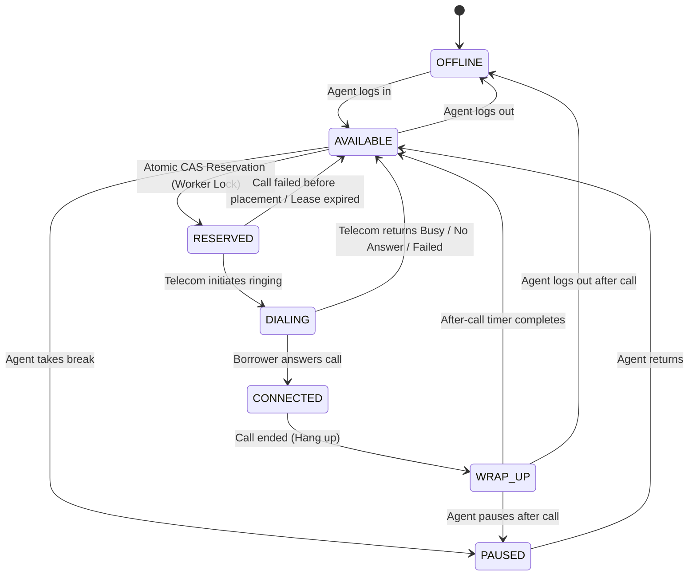

# Agent State Machine Specification

## 1. Overview
The **Agent State Machine** models the complete lifecycle of a collections call agent in the SmartDialer system. It ensures that no agent can be allocated to more than one call simultaneously, handles graceful disconnections, and guarantees safe recovery when distributed workers crash.

---

## 2. Agent States

| State | Description | Next Permitted States |
| :--- | :--- | :--- |
| `OFFLINE` | Agent is logged off and not accepting calls. | `AVAILABLE` |
| `AVAILABLE` | Agent is idle and ready to be matched with an inbound answer or assigned an outbound call. | `RESERVED`, `PAUSED`, `OFFLINE` |
| `RESERVED` | An atomic lease lock has been placed on the agent by a specific worker (`workerId`). No other worker can acquire this agent. | `DIALING`, `AVAILABLE` (if call canceled/failed), `PAUSED`, `OFFLINE` |
| `DIALING` | Outbound call is in flight (ringing at telecom provider) bound to this agent (Progressive Mode). | `CONNECTED`, `AVAILABLE` (if call failed), `WRAP_UP` |
| `CONNECTED` | Agent is actively speaking with the borrower. Audio channel is live. | `WRAP_UP` |
| `WRAP_UP` | Call has completed. Agent is completing after-call work (disposition, notes). Automatically transitions back to `AVAILABLE` after wrap-up timer expires. | `AVAILABLE`, `PAUSED`, `OFFLINE` |
| `PAUSED` | Agent is temporarily on break / away from keyboard. Not eligible for dialing. | `AVAILABLE`, `OFFLINE` |

---

## 3. State Transition Diagram



---

## 4. Concurrency & Double-Reservation Prevention

### Problem Statement
> *"Assume two workers see the same available agent at almost the same time. Both must not be able to reserve that agent. Explain how you prevent it."*

### Implementation & Guarantee
Double-reservation is prevented at the storage layer via **Atomic Compare-And-Swap (CAS)** with optimistic version checking:

```typescript
// From src/storage/store.ts
reserveAgent(agentId: string, workerId: string, leaseDurationMs = 10_000): Agent | null {
  const agent = this.agents.get(agentId);
  if (!agent) return null;

  // CAS CHECK: Must be currently AVAILABLE
  if (agent.state !== AgentState.AVAILABLE) {
    return null; // Collision detected: Another worker got here first
  }

  // Atomically transition state and set worker lease
  const updated = transitionAgent(agent, AgentState.RESERVED, workerId);
  updated.leaseExpiresAt = Date.now() + leaseDurationMs;
  updated.lockedBy = workerId;
  this.agents.set(agentId, updated);
  return updated;
}
```

### In a Distributed Database (PostgreSQL / Redis)
In an enterprise cluster, this is backed by either:
1. **Relational Database (PostgreSQL):**
   ```sql
   UPDATE agents 
   SET state = 'RESERVED', locked_by = :workerId, lease_expires_at = NOW() + INTERVAL '10 seconds', version = version + 1
   WHERE id = :agentId AND state = 'AVAILABLE';
   ```
   PostgreSQL executes this under an exclusive row-level lock. Only one worker updates the row (`1 row affected`); all other concurrent workers receive `0 rows affected`.
2. **Distributed Redis (In-Memory Key-Value):**
   Using Redis Lua scripting:
   ```lua
   if redis.call("hget", KEYS[1], "state") == "AVAILABLE" then
     redis.call("hmset", KEYS[1], "state", "RESERVED", "lockedBy", ARGV[1], "leaseExpiresAt", ARGV[2])
     return 1
   else
     return 0
   end
   ```

---

## 5. Agent Disappearance During Call Setup
If an agent unexpectedly disconnects (`PAUSED` or `OFFLINE`) while a call is dialing or ringing:
1. When the `ANSWERED` event arrives, the worker detects that the assigned agent is no longer `AVAILABLE` or `DIALING`.
2. The worker initiates a **rapid re-route** to any other available agent in the campaign pool.
3. If no replacement agent exists, the call is cleanly logged as `AGENT_DISAPPEARED_DURING_SETUP`, the borrower is released for retry, and compliance monitors are alerted.
