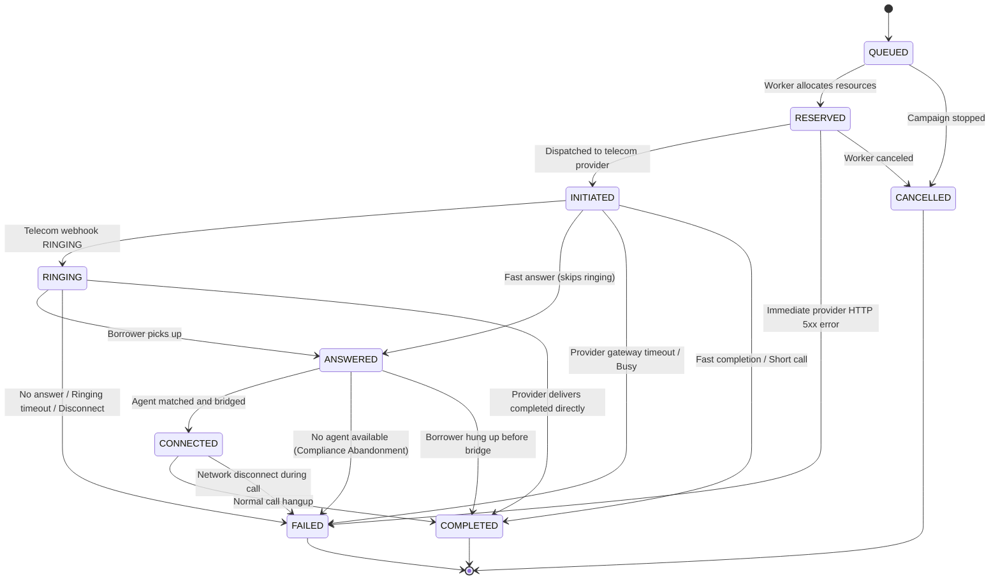

# Call State Machine Specification

## 1. Overview
The **Call State Machine** manages the entire lifecycle of outbound calls placed to debt borrowers. External telecom providers are notoriously unreliable: webhooks can arrive **duplicated**, **delayed**, or **completely out-of-order** (e.g., `COMPLETED` before `ANSWERED`). The call state machine guarantees system consistency despite adversarial network conditions.

---

## 2. Call States

| State | Monotonic Rank | Terminal? | Description |
| :--- | :---: | :---: | :--- |
| `QUEUED` | 0 | No | Call record created in dialer queue. |
| `RESERVED` | 1 | No | Borrower and/or agent locked for this outbound attempt. |
| `INITIATED` | 2 | No | Call placement request dispatched to telecom provider API. |
| `RINGING` | 3 | No | Telecom provider confirmed borrower device is ringing. |
| `ANSWERED` | 4 | No | Borrower answered call (audio bridge establishing). |
| `CONNECTED` | 5 | No | Agent and borrower bridged on live call. |
| `COMPLETED` | 6 | **Yes** | Call ended normally (hang up). Terminal. |
| `FAILED` | 6 | **Yes** | Call failed (Busy, No Answer, Timeout, Network Error, Abandoned). Terminal. |
| `CANCELLED` | 6 | **Yes** | Call canceled before placement. Terminal. |

---

## 3. State Transition Diagram



---

## 4. Handling Adversarial Telecom Behaviors

### 1. Duplicate Events
**Scenario:** Telecom provider sends `ANSWERED` three times in rapid succession.
* **Solution:**
  1. Every incoming webhook carries a unique `eventId` and monotonic sequence number.
  2. The store maintains an in-memory / database `processedEventIds` index.
  3. If a duplicate arrives, the transition validator detects `call.state === newState` and idempotently ignores the event without triggering duplicate agent allocation or metric corruption.

### 2. Out-of-Order Events
**Scenario:** Network latency causes events to arrive as:
`COMPLETED` $\rightarrow$ `ANSWERED` $\rightarrow$ `RINGING`
* **Solution: Monotonic State Ranking**
  ```typescript
  const currentRank = getCallStateRank(call.state);
  const newRank = getCallStateRank(newState);

  // 1. If currently in a terminal state (COMPLETED, rank 6), reject any further changes
  if (isTerminalCallState(call.state)) {
    return { status: 'stale', reason: `Terminal state cannot regress` };
  }

  // 2. Reject lower-ranked events
  if (newRank < currentRank) {
    return { status: 'stale', reason: `Out-of-order event rejected` };
  }
  ```
  When `COMPLETED` (rank 6) arrives first, the call moves to `COMPLETED`. When `ANSWERED` (rank 4) and `RINGING` (rank 3) arrive later, their rank is strictly lower than 6, so they are safely discarded as stale. The system never breaks.

### 3. Worker Crash Immediately After `ANSWERED`
**Scenario:** Worker receives `ANSWERED`, writes to call state, and immediately crashes before bridging audio to agent.
* **Solution:**
  1. Borrower eventually hangs up due to silence, prompting provider to send `COMPLETED`.
  2. The `COMPLETED` webhook is processed by any available worker in the pool.
  3. The **Reconciliation Daemon** sweeps expired agent leases. If an agent was reserved with no active audio stream, their lease expires and they are automatically returned to `AVAILABLE`.
